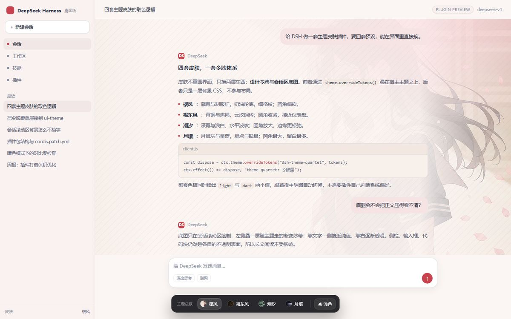
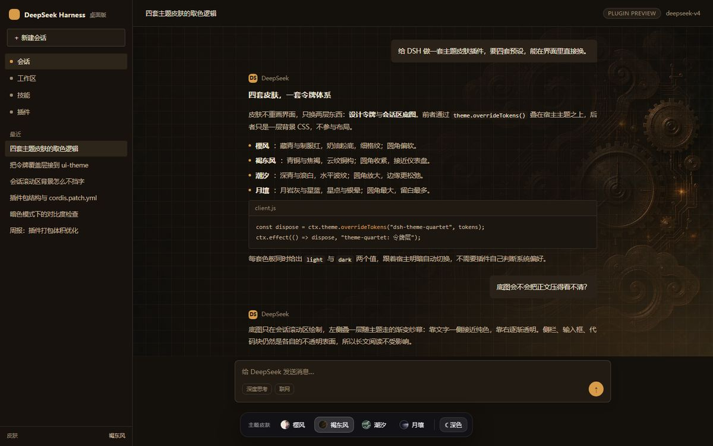
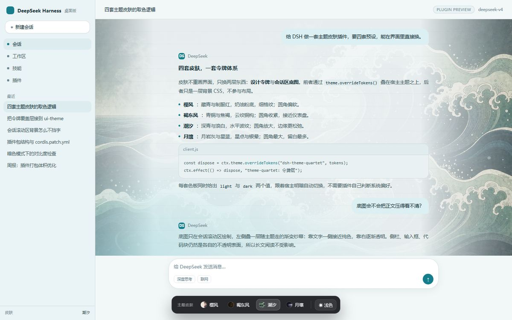
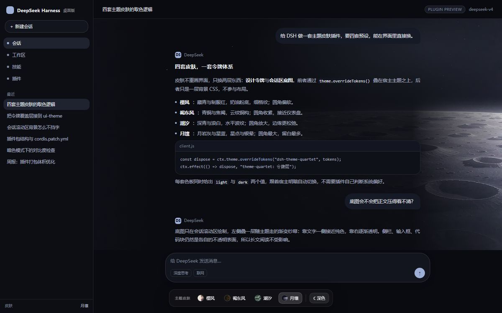

# 主题四合 · dsh-theme-quartet

给 **DeepSeek Harness（DSH）桌面版 Web 界面**用的换肤插件。四套预设皮肤，一个悬浮换肤面板，明暗自动跟随。

不修改宿主源码、不替换渲染逻辑：只叠一层设计令牌（`--dsw-alias-*` / `--dsw-specific-*`）+ 一层装饰 CSS。

## 四套皮肤

| 皮肤 | 配色 | 气质 | 圆角 |
| --- | --- | --- | --- |
| **樱风**（JK） | 藏青 / 制服红 / 奶油粉 | 制服、樱花、细格纹 | 偏软（16px） |
| **褐东风** | 青铜 / 焦褐 / 仪表金 | 云纹铜构、仪表盘 | 收紧（4px） |
| **潮汐** | 深青 / 靛蓝 / 浪白 | 青海、水平波纹 | 放大（20px） |
| **月壤** | 月岩灰 / 星蓝 / 银紫 | 陨野、星点、银晕 | 最大（30px） |

每套都写了 light / dark 两套色板，切换宿主明暗时自动换值。

| 樱风（浅色） | 褐东风（深色） |
| --- | --- |
|  |  |

| 潮汐（浅色） | 月壤（深色） |
| --- | --- |
|  |  |

> 截图来自 `preview.html` 的宿主替身，不是 DSH 真实界面；装进 DSH 后布局由宿主决定，配色与底图一致。

## 安装

### 方式一：一键脚本（推荐）

```bat
node tools\install.mjs
```

脚本做三件事，都是幂等的：

1. 把整个包复制到 `%USERPROFILE%\.dsh\profiles\desktop\node_modules\dsh-theme-quartet`；
2. 在 `cordis.patch.yml` 里补一条 `insert: theme-quartet`（已有就跳过）；
3. 打印需要重启的提示。

然后**完全退出并重启 DeepSeek Harness**（loader 组合变了，必须重启；之后改 bundle 只需刷新页面）。

### 方式二：手动

1. 复制 `dsh-theme-quartet` 文件夹到
   `%USERPROFILE%\.dsh\profiles\desktop\node_modules\dsh-theme-quartet`
2. 在 `%USERPROFILE%\.dsh\profiles\desktop\cordis.patch.yml` 末尾追加：

```yaml
- insert:
    - id: theme-quartet
      name: dsh-theme-quartet
```

3. 重启 DSH。

### 方式三：CLI（若 `dsh` 在 PATH 里）

```bat
dsh plugin --profile desktop add "<本目录绝对路径>"
```

## 使用

- **右下角圆钮**：点开换肤面板，2×2 卡片点选即生效；圆钮本身显示当前皮肤的画面。
- **Alt + Shift + S**：开关面板。
- **面板打开时按 1 / 2 / 3 / 4**：直接切到对应皮肤。
- **双击圆钮**：恢复原生外观，并把圆钮位置复位。
- **拖动圆钮**：位置会被记住，方便避开右下角的其它悬浮控件。
- **恢复原生外观**：面板底部按钮，整层令牌摘掉，界面回到未装插件的样子。

选择存在 `localStorage`（键 `dsh-theme-quartet.skin`），不进 DSH 的设置文档。

## 为什么不写进「设置 → 主题」

DSH 的主题偏好字段有白名单，只接受 `light` / `dark` / `system`，自定义主题 id 存不进去（写进去也会在下次读取时被回滚）。所以皮肤选择由插件自己持久化，面板标题仍是「主题皮肤」，入口在右下角而不是设置页。

如果以后宿主开放自定义主题注册，把 `SKINS` 注册成主题即可，令牌表可以直接复用。

## 与其它皮肤插件共存

同一套令牌层被多个插件覆盖时，**后注册的那层逐令牌胜出**。同时装 `dsh-joi-channel-theme` 之类的皮肤，会出现"一半这套、一半那套"的混色。建议一次只启用一个皮肤插件；关掉本插件的方式是从 `cordis.patch.yml` 移除那三行。

## 自定义

```bat
node build.mjs
```

- 色板、圆角、装饰层：`src/skins.mjs`（唯一数据源，预览页与插件共用）。
- 面板 UI：`src/client.template.js` 里的 `UI_CSS`。
- 底图：替换 `assets/<slug>.webp`，或用 `tools/compress.py` 从原始 PNG 重新裁切压缩（会自动切掉生成器水印条）。

产物：

- `lib/client.js` — 浏览器半边（自包含，无运行时依赖，底图以 data URI 内嵌）
- `preview.html` — 离线预览页，不装插件也能看四套皮肤

## 目录结构

```
dsh-theme-quartet/
├─ package.json          # dsh.bundle.patch + dsh.client 声明
├─ cordis.patch.yml      # 往 loader 组合里插一行
├─ lib/
│  ├─ index.js           # 宿主半边：空 apply，只负责"让包出现在 entries 里"
│  └─ client.js          # 浏览器半边：令牌覆盖 + 装饰 CSS + 换肤面板
├─ src/                  # 源码（色板 / 客户端模板 / 预览模板）
├─ assets/               # 压缩后的底图（WebP，合计约 300 KB）
├─ tools/                # 压缩脚本、安装脚本、冒烟测试页
└─ preview.html          # 离线预览
```

## 实现要点

- 令牌通过 `ctx.theme.overrideTokens("dsh-theme-quartet", tokens)` 叠层，`ctx.effect` 负责在插件卸载时整层摘除；换肤时用同一个 source 再调一次即可替换（不闪原生色）。
- 底图只画在 `[data-conversation-scroll]` 上，用 90° 渐变做「中间纸面、两侧透气」的纱幕；侧栏、输入框、代码块保持各自的不透明表面，长文阅读不受影响。
- 面板用 Shadow DOM 隔离，宿主 CSS 进不来，面板样式也漏不出去；配色仍读 `--dsw-alias-*`，所以面板自己也会跟着皮肤变。
- 没有主题服务时降级为 `body` 上的 `!important` 变量表，功能不缺，只是换肤动画会少一点。

## 已验证环境

- DeepSeek Harness 桌面版（`E:\aadsh`），profile `desktop`，令牌体系 `--dsw-*`
- Edge / Chromium（`color-mix`、`backdrop-filter`、Shadow DOM 均可用）
- 冒烟测试：`tools/smoke.html`（宿主替身，验证挂载、79 个令牌覆盖、四张卡片切换）

## 已知限制

- 底图在宽窗口中会被正文列挤到两侧，角色只露出边缘 —— 这是为了保证正文可读性做的取舍。想要更强的人物存在感，可以调低 `src/skins.mjs` 里 `normalize()` 的 `veil` 透明度，代价是文字对比度下降。
- 面板位置按像素记忆，换到更小的窗口会被夹回可视区。
- 主题层的最终解释权在宿主：DSH 大版本改动 `--dsw-*` 令牌名时，需要同步 `src/skins.mjs` 的映射表。

## 许可

MIT。底图由本插件自行生成（AI 绘制），随包分发。
